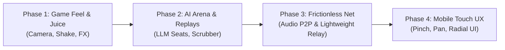

# Battle Drones-Inspired Roadmap: Race to the Crystal (Web Client)

Inspired by Simon Willison's [*Battle Drones*](https://simonwillison.net/2026/Oct/20/battledrones/)—a vibe-coded browser RTS featuring audio-based multiplayer, AI model matches, and iterative game-feel tuning—this roadmap outlines strategic enhancements for the browser-based 3D client of **Race to the Crystal** ([`web_server/`](file:///var/home/tluker/repos/kukicha/race-to-the-crystal/web_server)).

---

## 1. Executive Summary

While *Race to the Crystal* possesses solid underlying game mechanics and an educational layer ([`learn/`](file:///var/home/tluker/repos/kukicha/race-to-the-crystal/learn)), the web client ([`web_server/`](file:///var/home/tluker/repos/kukicha/race-to-the-crystal/web_server)) can be transformed from a functional 3D viewer into a frictionless, tactile, and AI-native arena.

Key vectors adapted from *Battle Drones*:
1. **The "Make it a LOT More Fun" Mandate:** Injecting screen shake, tactical telegraphing, and camera choreography.
2. **AI Arena & Battle Spectator Mode:** Enabling LLMs to compete via standard tool interfaces with live radio chatter and round-by-round scrubbers.
3. **Acoustic / Serverless Multiplayer:** Zero-setup local multiplayer over Web Audio ultrasonic chirps.
4. **Stateless Relay Architecture:** Low-cost, serverless-friendly room routing.
5. **Mobile-First Touch Ergonomics:** Fluid gestures for phones and tablets.

---

## 2. Phased Roadmap

---

### Phase 1: Game Feel & "Juice" (Visuals & Audio)

> *"Make it a LOT more fun."* — Simon Willison's prompt that transformed mechanical gameplay into an engaging experience.

#### 1.1 Dynamic Camera Choreography
- **Target File:** [`web_server/static/camera_controller.js`](file:///var/home/tluker/repos/kukicha/race-to-the-crystal/web_server/static/camera_controller.js)
- **Objective:** Move beyond static orbit cameras to contextual, cinematic views.
- **Tasks:**
  - Implement smooth camera framing when a generator is overloaded or captured.
  - Add dramatic zoom-in during crystal extraction and decisive combat encounters.
  - Introduce configurable camera follow modes for the active player's tokens during automated turns.

#### 1.2 Screen Shake & Impact Particles
- **Target Files:** [`web_server/static/game_client.crystal_effects.js`](file:///var/home/tluker/repos/kukicha/race-to-the-crystal/web_server/static/game_client.crystal_effects.js), [`web_server/static/renderer.base.js`](file:///var/home/tluker/repos/kukicha/race-to-the-crystal/web_server/static/renderer.base.js)
- **Objective:** Add visceral tactile feedback on state-altering events.
- **Tasks:**
  - Babylon.js camera trauma/shake system triggered on attacks, generator explosions, and crystal capture.
  - Particle bursts on token destruction and power-up collection.
  - Floating combat text and damage indicators directly above affected tokens.

#### 1.3 Audio Punch & Dynamic Sound Synthesis
- **Target File:** [`web_server/static/audio_manager.js`](file:///var/home/tluker/repos/kukicha/race-to-the-crystal/web_server/static/audio_manager.js)
- **Objective:** Enhance Web Audio API soundscapes with dynamic feedback.
- **Tasks:**
  - Synthesize responsive bass hits and chord rises during turn countdowns and crystal extractions.
  - Add audio ducking so ambient hums yield during explosive combat events.

#### 1.4 Tactical Telegraphing & Threat Overlays
- **Target File:** [`web_server/static/renderer.indicators.js`](file:///var/home/tluker/repos/kukicha/race-to-the-crystal/web_server/static/renderer.indicators.js)
- **Objective:** Lower cognitive load by visualizing strategic tension.
- **Tasks:**
  - Projected threat tiles on hover (showing which enemy tokens threaten a given cell).
  - Generator control radius highlights and crystal extraction path visualizers.

---

### Phase 2: AI Arena, Spectator Mode & Battle Replays

> *Battle Drones demonstrated the spectator appeal of LLMs playing against each other under fog-of-war constraints.*

#### 2.1 Standardized AI Tool Seat (MCP / HTTP / WebSocket)
- **Target Files:** [`web_server/static/network_manager.js`](file:///var/home/tluker/repos/kukicha/race-to-the-crystal/web_server/static/network_manager.js), [`game/api.kuki`](file:///var/home/tluker/repos/kukicha/race-to-the-crystal/game/api.kuki), [`learn/learn_api.kuki`](file:///var/home/tluker/repos/kukicha/race-to-the-crystal/learn/learn_api.kuki)
- **Objective:** Allow external AI models (Gemini, Claude, GPT, local models) to connect to browser games as players.
- **Tasks:**
  - Define an agent seating endpoint exposing tool schemas (`get_visible_state`, `move_token`, `attack`, `capture_generator`).
  - Restrict state payload to the agent's visible perimeter (fog-of-war compliance).
  - Capture agent "thoughts", "radio chatter", and explanations alongside each move.

#### 2.2 Live "Radio Chatter" & Agent HUD
- **Target File:** [`web_server/static/ui_manager.js`](file:///var/home/tluker/repos/kukicha/race-to-the-crystal/web_server/static/ui_manager.js)
- **Objective:** Bring the AI's internal reasoning into the browser UI.
- **Tasks:**
  - Add a dedicated "Tactical Comms" sidebar showing real-time banter and strategic reasoning from competing agents.
  - Avatar badges and sentiment indicators for each AI combatant.

#### 2.3 Battle Record Viewer & Replay Scrubber
- **Target File:** [`web_server/static/state_manager.js`](file:///var/home/tluker/repos/kukicha/race-to-the-crystal/web_server/static/state_manager.js)
- **Objective:** Step-by-step review for post-match analysis and learner debugging.
- **Tasks:**
  - Record timestamped state snapshots and action payloads into a lightweight JSON timeline.
  - Add a scrubber slider to the HUD allowing users to pause, rewind, fast-forward, and inspect board states at any turn.
  - Export and import battle log files (`.rttc-battle.json`) for sharing and curriculum grading.

---

### Phase 3: Frictionless & Serverless Multiplayer

> *Eliminating infrastructure hurdles: audio data modems for local play and stateless room relays for cloud play.*

#### 3.1 Acoustic / Ultrasonic P2P Multiplayer (Web Audio Modem)
- **Target File:** [`web_server/static/audio_manager.js`](file:///var/home/tluker/repos/kukicha/race-to-the-crystal/web_server/static/audio_manager.js)
- **Objective:** Enable two devices sitting side-by-side to play without Wi-Fi, pairing codes, or central servers.
- **Tasks:**
  - Implement a near-ultrasonic (18–20 kHz) or acoustic audible chirp modem using Web Audio API oscillators and `AnalyserNode`.
  - Encode compact turn messages (e.g. 16-byte binary or compressed hex) into chirp bursts.
  - Microphone input receiver with parity/checksum verification for packet error handling.

#### 3.2 Lightweight Stateless WebSocket Relay Mode
- **Target Files:** [`server/`](file:///var/home/tluker/repos/kukicha/race-to-the-crystal/server/), [`web_server/static/network_manager.js`](file:///var/home/tluker/repos/kukicha/race-to-the-crystal/web_server/static/network_manager.js)
- **Objective:** Provide an ultra-low-cost hosting option without stateful Go server instances or Mercure hubs.
- **Tasks:**
  - Create a lightweight room relay (e.g. simple WebSocket room echo server) that forwards messages between players.
  - Allow the host browser (or a WASM-compiled Kukicha game logic worker) to execute state validation.
  - Seamless fallback between full authoritative server mode and lightweight relay mode.

---

### Phase 4: Mobile-First Browser UX & Touch Ergonomics

> *Battle Drones was designed to run seamlessly on mobile touchscreens without requiring physical keyboards.*

#### 4.1 Touch Gesture Navigation
- **Target File:** [`web_server/static/input_handler.js`](file:///var/home/tluker/repos/kukicha/race-to-the-crystal/web_server/static/input_handler.js)
- **Objective:** Eliminate desktop keyboard dependency (`WASD`, `Q`/`E`, `Space`).
- **Tasks:**
  - Single-finger drag for camera orbit and orientation.
  - Two-finger pinch for zoom in/out; two-finger pan for board translation.
  - Tap-to-select token with high-contrast touch hitboxes (preventing misclicks on small screens).

#### 4.2 Radial Action Palette & Responsive HUD
- **Target Files:** [`web_server/static/ui_manager.js`](file:///var/home/tluker/repos/kukicha/race-to-the-crystal/web_server/static/ui_manager.js), [`web_server/static/index.css`](file:///var/home/tluker/repos/kukicha/race-to-the-crystal/web_server/static/index.css)
- **Objective:** Provide thumb-reachable gameplay controls.
- **Tasks:**
  - Replace desktop hotkeys with an intuitive radial menu around selected tokens (Move, Attack, Extract).
  - Prominent "End Turn" floating action button (FAB) sized for touch interaction.
  - Collapsible panels for player scores, turn timers, and tactical comms.

---

## 3. Success Metrics & Verification

| Milestone | Target Deliverable | Verification Criteria |
|---|---|---|
| **M1: Game Juice** | Camera & FX overhaul in [`renderer.*.js`](file:///var/home/tluker/repos/kukicha/race-to-the-crystal/web_server/static) | Attacks and generator events trigger smooth camera zoom, screen shake, and floating combat text. |
| **M2: Replay Scrubber** | Turn scrubber in [`state_manager.js`](file:///var/home/tluker/repos/kukicha/race-to-the-crystal/web_server/static/state_manager.js) | Completed matches can be rewound, scrubbed, and replayed at 1x, 2x, and 5x speeds. |
| **M3: AI Arena HUD** | LLM battle viewer in [`ui_manager.js`](file:///var/home/tluker/repos/kukicha/race-to-the-crystal/web_server/static/ui_manager.js) | Dual AI agent battle displays real-time tool calls and tactical commentary in browser. |
| **M4: Mobile Controls** | Touch integration in [`input_handler.js`](file:///var/home/tluker/repos/kukicha/race-to-the-crystal/web_server/static/input_handler.js) | Complete match can be played on mobile/tablet browser using touch gestures only. |
| **M5: Audio Sync (P2P)** | Acoustic modem in [`audio_manager.js`](file:///var/home/tluker/repos/kukicha/race-to-the-crystal/web_server/static/audio_manager.js) | Two laptops/phones exchange turns across audio chirps in the same room with no server. |
