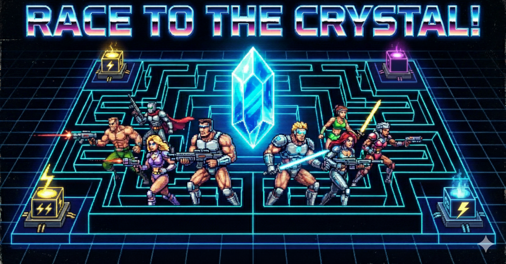

# Race to the Crystal

A networked multiplayer strategy game for 2-4 players with Tron/Battlezone-style vector graphics. Play in your browser (3D web client) or locally on the desktop (2D).

> **AI Disclosure**: This project was created with AI assistance for both code and assets.

## About

Race to the Crystal is a turn-based strategy game where players compete to charge a central crystal to 80 by deploying tokens across an 18x18 grid. Features:

- **Web Client**: Browser-based 3D view (dependency-free vanilla WebGL2 by default; Babylon.js 8 available behind `?renderer=babylon` for one release — see [docs/VANILLA-JS.md](docs/VANILLA-JS.md)) — the networked client
- **Desktop Client**: 2D top-down view (Kukicha + Ebitengine) — local play only
- **Network Multiplayer**: Web clients and AI clients play together on the same server
- **Fog of War**: You see the terrain, but only the enemy tokens your own tokens are near
- **AI Players**: Multiple strategy modes (random, aggressive, defensive)
- **Strategic Gameplay**: Generators, mystery squares, combat, and token deployment
- **GPU-Accelerated Graphics**: Tron-style wireframes with glow effects
- **Game Feel & Juice**: trauma-based screen shake, impact particles, floating combat numbers, dynamic camera push-ins, master audio bus with ducking
- **Tactical Comms**: agents broadcast radio chatter into a collapsible in-match feed
- **Replay Scrubber**: export/import `.rttc-battle.json` files and scrub a match turn by turn
- **Agent Seat (MCP)**: LLM agents play through a thin stdio MCP proxy (`mcp/`) over the REST API
- **Spectator Seat**: `POST /api/game/{id}/spectate` issues a read-only token

## Tech Stack

- **Backend**: Kukicha (compiles to Go) — HTTP/WebSocket + REST API with JWT authentication, built on `stdlib/http`
- **Desktop Client**: Kukicha + Ebitengine (2D top-down)
- **Web Client**: vanilla WebGL2 by default (no libraries, ~4,600 lines — [docs/VANILLA-JS.md](docs/VANILLA-JS.md)); Babylon.js 8 behind `?renderer=babylon` as a one-release rollback hatch. The WebSocket carries the full game state and a sequenced event stream
- **Testing**: 94 Kukicha unit tests covering core game logic and the server's action validation

## Agent / MCP client

An agent seat needs a game, a player token and a game id. Create or join a game
over the HTTP API (HTTP seats are labelled `HTTP_AI` automatically and get the
longer agent turn timeout), then run the MCP proxy against the running server:

```bash
cd mcp && kukicha build . && \
GAME_SERVER_URL=http://localhost:8080 \
GAME_TOKEN=<jwt-from-create-or-join> \
GAME_ID=<game-id> \
./mcp
```

The proxy exposes `get_visible_state`, `get_legal_actions`, `move_token`,
`attack`, `deploy_token`, `end_turn` and `say`. It holds no game logic.

## Quick Start

The web client and the game server are two processes: the web server serves the
page and proxies the game API to the game server.

```bash
# Terminal 1 — the game server (HTTP + WebSocket, port 8080)
make server-run

# Terminal 2 — the web client (port 8000)
make web-server-run
```

Then open **http://localhost:8000** in your browser, enter a name and connect.
The web client renders with its dependency-free WebGL2 renderer by default
(since 2026-11-10); to fall back to Babylon.js for one release, open
**http://localhost:8000/?renderer=babylon** (see [docs/VANILLA-JS.md](docs/VANILLA-JS.md)).

To play locally on the desktop instead:

```bash
make desktop-run
```

## Game Modes

### 1. Local Single-Player (Desktop)

```bash
make desktop-run
```

The desktop client runs the game in-process against the `game` package — no
server involved. Its "Network Game" menu entry is a stub, so it cannot join a
networked match.

### 2. Network Multiplayer (Web)

Start the game server and the web server (see [Quick Start](#quick-start)),
then open http://localhost:8000. Create a game, and have the other player join
by game ID or from the lobby browser.

### 3. AI Players

The AI client is a Kukicha program (`client/ai/`) that speaks the same HTTP
API as the browser. It runs the `poll` subcommand, which asks the server for
the state on a timer.

```bash
make ai-client        # builds ./race-ai-client
./race-ai-client poll --create "My Game" --name "Bot" --strategy aggressive
./race-ai-client poll --join <game-id> --strategy defensive
./race-ai-client --help
```

The strategy is one of `random`, `aggressive` or `defensive`. The server URL
defaults to `http://localhost:8080`; pass `--server` to point it elsewhere.

An AI player and a web player can share a match.

## Controls

**Web Client:**

- **Left-click**: Select a token, then click again to move or attack
- **Drag (left or right button)**: Pan the camera
- **Mouse wheel**: Zoom in/out
- **Space / Enter**: End turn
- **R**: Open the deploy menu
- **ESC**: Cancel the current action
- **V**: Toggle overview / first-person view
- **WASD / Arrow keys**: Move your token in first-person, pan the camera in overview
- **TAB**: Cycle through your tokens (first-person)
- **M**: Toggle music and sound
- **Ctrl+Q**: Quit

The in-game **Controls** panel lists the full set, and the mobile action bar
provides the same actions as buttons.

## Game Rules

1. **Win Condition**: First to 80 crystal charge (hold crystal for +10/turn; hold a generator for +5/turn, Reactor +10)
2. **Movement**: Tokens move 2 spaces (10-8 HP), 3 spaces (6 HP), or 4 spaces (4 HP) — damaged tokens are faster
3. **Combat**: Attack adjacent enemies (damage = attacker HP ÷ 2). The defender counters for half its attack power; defenders on a generator/crystal get +1. Attacking with 2+ allies adjacent negates the counter (flanking)
4. **Generators**: Recapturable control points. Hold with 2 tokens for 2 consecutive end-of-turn checks to capture; lose the tokens and you lose the buff. Progress decays by 1 on disruption, not wipes to 0. Each gives a unique buff: MOVE_ENGINE (+1 move), REACTOR (+10 charge/turn), FORGE (+2 heal/turn to adjacent), DEPLOY_ARRAY (extra deploy per turn)
5. **Crystal Pulse**: 1 damage per end-turn to all tokens adjacent to the crystal
6. **Mystery Squares**: Random heal or teleport events
7. **Turn Timer**: You have 60 seconds to complete your turn. The HUD counts
   down, and if the timer runs out your turn is passed on automatically. AI
   players get 120 seconds, since a model may need a while to think.
7. **Fog of War**: You see the whole board, but only the enemy tokens your own
   tokens are near — roughly 3 cells away. Spreading your tokens out gives
   you a wider view. Enemy tokens out of sight are hidden, and so is who is
   holding the crystal or a generator until you can see it.

**See [docs/GAME.md](docs/GAME.md) for complete rules and mechanics.**

## Configuration

The game server and web server are configured through environment variables:

| Variable | Default | Used by | Meaning |
|---|---|---|---|
| `HTTP_PORT` | `8080` | game server | HTTP + WebSocket port |
| `JWT_SECRET_KEY` | random per boot | game server | Token signing key |
| `TURN_TIMEOUT_SECONDS` | `60` | game server | Seconds a human has to move |
| `AGENT_TURN_TIMEOUT_SECONDS` | `120` | game server | Seconds an AI player has to move |
| `WS_ALLOWED_ORIGINS` | *(any)* | game server | Comma-separated origins allowed to open a WebSocket |
| `WEB_PORT` | `8000` | web server | Port the web client is served on |
| `GAME_SERVER_URL` | `http://localhost:8080` | web server | Where the game server lives |
| `DEBUG` | `false` | game server | Verbose logging |

## Development

### Project Structure

```
race-to-the-crystal/
├── game/          # Core game logic + *_test.kuki unit tests (no rendering deps)
│   └── game_events.kuki  # The game event vocabulary (see below)
├── learn/         # Learn-to-program package: LearnerAPI + in-process simulation
│   └── examples/  # Runnable learner scripts (01-hello … 10-strategy-ladder)
├── client/        # Desktop client (Kukicha + Ebitengine) and the AI client
├── server/        # Game server (HTTP/WebSocket + REST, JWT auth)
├── web_server/    # Web client host (web frontend + reverse proxy)
│   │              #   Vanilla WebGL2 by default; Babylon.js behind ?renderer=babylon (one release)
│   ├── static/    # The web client (no build step)
│   │   └── webgl2/  #   Vanilla WebGL2 renderer (default since 2026-11-10)
├── shared/        # Constants, enums, types and error codes
├── deployment/    # Container deployment configs
└── docs/          # Detailed documentation
    └── tutorials/ # Learn to Program with Kukicha course (10 chapters)
```

### The game event stream

The server broadcasts a sequenced stream of game **events** alongside the full
state:

```json
{"type":"EVENT","game_id":"abc","seq":42,
 "event":{"type":"COMBAT_RESOLVED","attacker_id":5,"defender_id":9,
          "attacker_position":[3,4],"defender_position":[5,6],
          "damage":5,"defender_killed":true}}
```

Events are what drive feedback — sound, particles, camera moves — and they
carry the positions they refer to, so a client never has to look information
up in the current state. The same vocabulary is used for the live stream and
for battle replays.

### Learn to program

Write Kukicha programs that play the game, no server needed — modeled on
*Learn to Program with Minecraft*. See `docs/tutorials/` for the course
and `learn/examples/` for runnable scripts:

```bash
make learn-run NAME=01-hello   # run a learner example
make learn-check               # type-check the learn package + all examples
make learn-test                # run the learn package tests
```

### Testing

```bash
make test              # Transpile the test sources, then run `go test ./...`
make test-verbose      # Same, with verbose output
make lint              # Check Kukicha formatting (kukicha fmt --check)
make smoke             # Headless boot/render gate for the vanilla WebGL2 path
```

`make smoke` (Playwright + SwiftShader WebGL2, `tools/smoke/smoke.mjs`) spawns
side servers on 8081/8001, drives a two-context lobby flow, and asserts a
clean boot and a non-trivial render per seat — a gate, not a behavioral
suite. First run needs `npm install` and `npx playwright install chromium`.

`make test` runs `kukicha brew` first, which is what turns `*_test.kuki` into
the `*_test.go` files `go test` compiles. Running `go test ./...` on its own
uses whatever was transpiled last, so use `make test` after editing a test.

### Deployment

Deploy to production using containerized deployment:

```bash
# See complete deployment guide
cat deployment/docs/DEPLOYMENT.md

# Quick: Development deployment (localhost)
cd deployment/dockerfiles
podman build -f Dockerfile -t localhost/race-to-the-crystal:latest ../..
podman build -f Dockerfile.web-server -t localhost/race-web-server:latest ../..
podman build -f Dockerfile.caddy -t localhost/race-caddy:latest ../..
# Deploy quadlets from deployment/development/
```

### Documentation

**Game & Development:**
- **[docs/GAME.md](docs/GAME.md)** - Complete game rules and mechanics
- **[docs/3D.md](docs/3D.md)** - Desktop 3D mode camera system and controls
- **[docs/NETWORK.md](docs/NETWORK.md)** - Network architecture and protocol
- **[docs/VANILLA-JS.md](docs/VANILLA-JS.md)** - Vanilla WebGL2 renderer: dropping Babylon.js (phases, gotchas, decision gate)
- **[AGENTS.md](AGENTS.md)** - Repository guide for agents and contributors

**Deployment:**
- **[deployment/docs/DEPLOYMENT.md](deployment/docs/DEPLOYMENT.md)** - Container deployment guide

## License

This project is licensed under the **MIT License**. See the [LICENSE](LICENSE.md) file for details.
